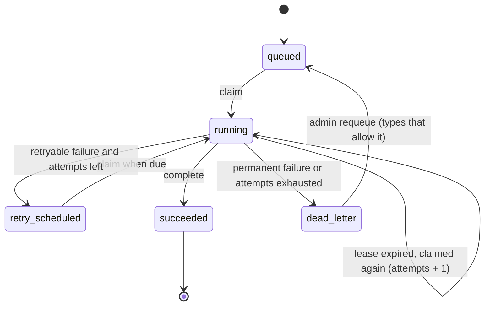

# Queue and observability (checkpoint 1.4)

## Flow of one email

```mermaid
sequenceDiagram
    participant B as Browser
    participant A as API
    participant D as PostgreSQL
    participant W as Worker
    participant M as Mail server
    B->>A: POST /auth/password/forgot
    A->>D: BEGIN; issue token (hash); INSERT task (secret: address, token); COMMIT
    A-->>B: 202 "we will send a link... (delivery hint)"
    loop every poll interval
        W->>D: claim (FOR UPDATE SKIP LOCKED), lease 120 s
    end
    W->>M: send email
    W->>D: complete: state=succeeded, payload erased
```

If the worker dies after `claim`, the lease expires and the next claim runs the task again.

## Task states



`cancelled` exists in the vocabulary for runs and is reserved for tasks.

## Tables (migration 0003)

| Table | RLS | Holds |
|---|---|---|
| `tasks` | no | Queue rows: type, payload (`args` and `secret`), state, attempts, lease, last_error (300 chars) |
| `worker_heartbeats` | no | One row per live worker |
| `workflow_runs` | yes (forced) | One row per analysis or parsing run |
| `workflow_steps` | yes (forced) | Steps of a run: state, duration, counts |
| `llm_calls` | no | One row per model call: tokens, cost, latency, model, prompt version. No content columns. Append-only for the app role |
| `user_stats` | no | Counters (profile entries, runs) kept by triggers, what admins may see |
| `invites` | no | New columns `created_by`, `revoked_at` |

Why the split is safe: see [ADR-0022](../adr/0022-queue-semantics-and-system-tables.md).

## State vocabulary

| Machinery (backend only) | Shown to the user (`ui_state`) |
|---|---|
| task `queued` / run `queued` | queued |
| task `running` / run `running` | processing |
| run `needs_user_input` | waiting_for_you |
| task `retry_scheduled` / run `retrying` | retrying |
| task `succeeded` / run `succeeded` | completed |
| run `failed` with retry possible | retry_available |
| run `failed` without retry / task `dead_letter` | permanently_failed |
| `cancelled` | cancelled |

Source of truth: `packages/domain/src/pv_domain/states.py`. The frontend list (`apps/web/src/lib/states.ts`) is compared with it by `npm run check:states` in CI.

## Questions this baseline answers

| Question | Where |
|---|---|
| What is the queue doing right now | Admin, System, or `.\scripts\pv.ps1 queue` |
| Is a worker alive | Admin, System (heartbeats) |
| Why did a task fail | Dead letters list, redacted last error, worker log lines by `task_id` |
| What did a run do, how long, which model, how many tokens, what cost | Runs, run detail (`workflow_steps`, `llm_calls`) |
| Who changed an account or invite | Admin, Audit log |
